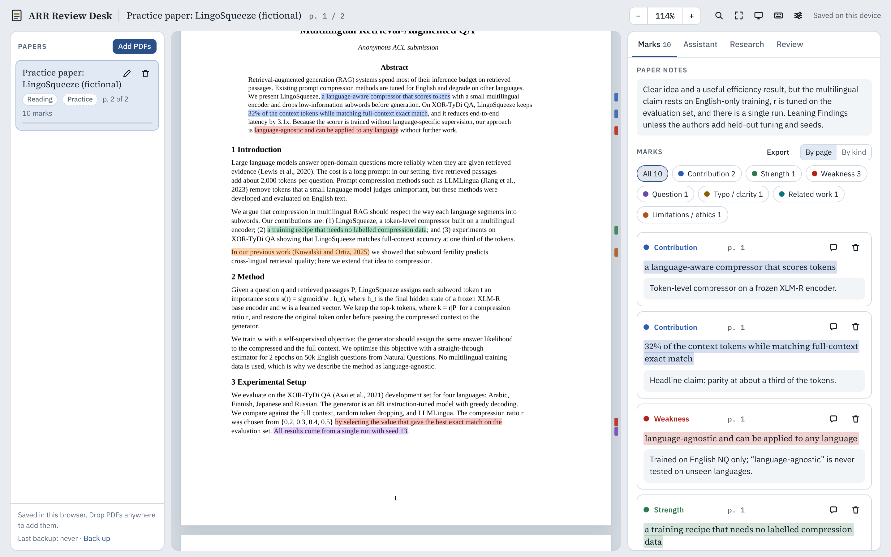
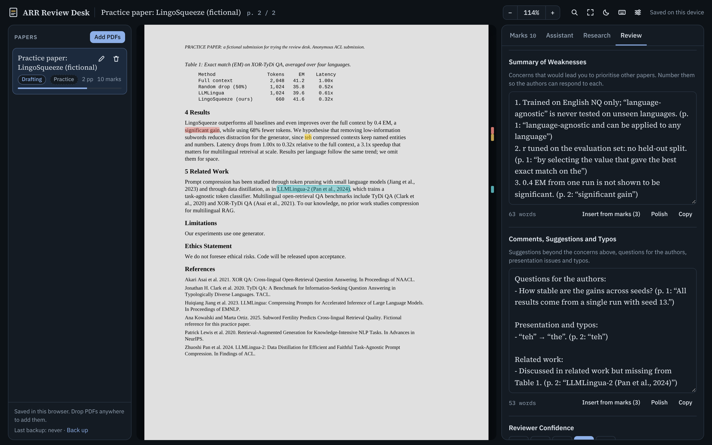

# Review Desk

*A reading and reviewing desk for ACL Rolling Review and other venues.*

Read, mark and review conference submissions in your browser. Each kind of highlight feeds one field of the [ACL Rolling Review](https://aclrollingreview.org/) reviewer form, so your review is half-written by the time you finish reading. An AI assistant is optional and can run entirely on your own computer.

Everything stays in your browser. There is no server, no account and no tracking.

**Use it online:** https://mnishant2.github.io/review-desk/ · **Or run it locally** (see [Run it yourself](#run-it-yourself))



## What it does

- **Several PDFs at once.** Add the papers you were assigned. Each one keeps its own marks, notes, assistant chat, review draft and reading position.
- **Marks that map to the review form.** Select text and press a number key:

  | Key | Mark | Feeds (ARR form) |
  |---|---|---|
  | `1` | Contribution | Paper Summary |
  | `2` | Strength | Summary of Strengths |
  | `3` | Weakness | Summary of Weaknesses (numbered) |
  | `4` | Question | Comments, Suggestions and Typos |
  | `5` | Typo / clarity | Comments, Suggestions and Typos |
  | `6` | Related work | Comments, Suggestions and Typos |
  | `7` | Limitations / ethics | Limitations and Societal Impact |

- **Notes on every mark**, a free-form notes area per paper, and loose notes that aren't tied to a passage.
- **The review form.** It has every ARR field and scale, including half points such as *Borderline Findings*. *Insert from marks* turns your marks into a starting list with page references for you to rewrite. A progress bar and a status (Reading, Drafting, Ready, Submitted) help you track several papers. Copy each section into OpenReview, or download the review as Markdown.
- **Find in paper** (`Ctrl`/`⌘`+`F`), with every match highlighted on the page.
- **Related-work search** through [OpenAlex](https://openalex.org/) or [Semantic Scholar](https://www.semanticscholar.org/), plus one-click links to ACL Anthology, Google Scholar and arXiv. Save any result as a related-work note.
- **Optional AI assistant** (see below):
  - discuss the paper, with page citations
  - ask about any passage
  - suggest search queries
  - polish the wording of a section
  - check a draft for scores that don't match its text, vague weaknesses or tone problems
- **Light and dark themes**, and a night mode that inverts page colours for reading in the dark.
- **Backups.** Download everything, with or without the PDFs, as one JSON file, and restore it in any browser.
- **Works offline.** pdf.js and the fonts are bundled, so nothing is loaded from a CDN.
- **A practice paper.** A short fictional submission with planted problems, so you can try the workflow before a real review.



## A workflow that works

1. **Skim, then read.** Read the abstract, figures and conclusion first. On the second pass, mark claims (`1`), evidence for and against (`2`, `3`) and open questions (`4`). Add a one-line note to each mark while it is fresh.
2. **Test your reading.** Step through your marks with `J`/`K`. Look up related work by method or task, never by the submission's title or system name, because an exact-title search can surface the authors' preprint.
3. **Write, then check.** Use *Insert from marks* in each field, rewrite the bullets in your own words, set the scores, and run *Check with AI* (or reread it yourself) before you copy the sections into OpenReview.

## The AI assistant (optional)

The assistant is **off** until you choose a provider in **Settings → AI assistant**. Requests go straight from your browser to the provider you pick:

| Provider | Setup | Where your text goes |
|---|---|---|
| **Claude** (Anthropic API) | Paste an API key from [console.anthropic.com](https://console.anthropic.com/settings/keys). Defaults: `claude-sonnet-5-5`, with `claude-haiku-5-5` for quick jobs and `claude-opus-5-5` for *Think longer*. You can change the model names. | Anthropic's API. Usage is billed to your account. |
| **Local model** (Ollama, LM Studio, llama.cpp, vLLM) | Choose *OpenAI-compatible server* and enter the server URL and model name. | Nowhere. It stays on your computer. |
| **Other OpenAI-compatible APIs** | Same, with the provider's URL and key. | That provider. |

Paper text is **not** shared by default. Each paper has a *Share paper text* switch in the Assistant tab. With it off, the assistant sees only your own notes and draft: no paper text and no quoted passages. With it on, Claude requests put the paper in a cached block, so follow-up questions cost less. The assistant is instructed not to write review sections for you.

> [!IMPORTANT]
> **Check your venue's rules first.** [ARR's reviewer guidelines](https://aclrollingreview.org/reviewerguidelines#q-can-i-use-generative-ai) don't allow putting a submitted manuscript, or any part of it, or your review into a generative AI tool that isn't privacy-preserving. They also don't allow AI to write your first draft, though help with paraphrasing your own review is acceptable. For ARR reviews, a local model is the safe choice. Other venues set their own policies.

### Using a local model with Ollama

```bash
ollama pull qwen2.5:14b          # or any model you like
# Let the desk talk to Ollama. Use the address you open the desk from:
OLLAMA_ORIGINS="https://mnishant2.github.io" ollama serve
```

In Settings, choose **OpenAI-compatible server**, keep the URL `http://localhost:11434/v1`, enter the model name, and press **Test connection**.

- If you run the desk locally at `http://localhost:…`, Ollama accepts it without `OLLAMA_ORIGINS`.
- Chrome may ask whether the page can access devices on your local network. Allow it.
- LM Studio: start the local server, turn on **CORS** in its server settings, and use `http://localhost:1234/v1`.
- Small local models have short context windows. If answers ignore the paper, lower **Paper text sent** in Settings, or raise the model's context length (`num_ctx` in Ollama).

## Your data

- Papers, PDFs, marks, chats and drafts are stored in your browser's IndexedDB, on this device only. Settings are kept in `localStorage`. API keys are kept there too, or only for the current tab if you untick *Remember API keys*.
- Browsers can clear site data, and other browsers or devices can't see it. **Download a backup** from Settings regularly. Settings also has a button that asks the browser not to clear your data automatically.
- What leaves your browser:
  - **Search:** only the query you type, sent to OpenAlex or Semantic Scholar.
  - **Assistant:** only what you send, and only to the provider you configured.
  - Nothing else. There are no analytics.

## Keyboard shortcuts

| Keys | Action |
|---|---|
| `1`–`7` | Mark the selected text |
| `A` / `L` | Ask the assistant about the selection / look it up |
| `J` / `K` | Next / previous mark |
| `Ctrl`/`⌘`+`F` | Find in the paper (`Enter` / `Shift`+`Enter` for next / previous) |
| `+` / `−` / `0` | Zoom in / zoom out / fit to width |
| `?` | Show all shortcuts |
| `Esc` | Close the open menu, find bar or dialog |

## Run it yourself

There is no build step. Download or clone the repository, then open `index.html` in your browser. For the most reliable experience, serve the folder:

```bash
git clone https://github.com/mnishant2/review-desk.git
cd review-desk
python3 -m http.server 8000
# open http://localhost:8000
```

To host your own copy, fork the repository. Then go to **Settings → Pages → Build and deployment** and choose **Deploy from a branch**, `main`, `/ (root)`.

## Add a review form for another venue

Forms live in [`src/config.js`](src/config.js). Add an entry to `FORMS`:

```js
const MYVENUE = {
  id: 'myvenue',
  name: 'My Venue 2027',
  venue: 'My Venue 2027',                 // used in assistant prompts
  intro: 'Copy each section into the review system.',
  checkNotes: 'Weaknesses should be numbered.',
  fields: [
    { k: 'summary', t: 'text', label: 'Summary', help: '…', pull: ['contrib'], req: true },
    { k: 'weaknesses', t: 'text', label: 'Weaknesses', pull: ['weakness'], req: true, numbered: true },
    { k: 'score', t: 'scale', label: 'Overall', values: [1, 2, 3, 4, 5], req: true,
      labels: { 1: 'Reject', 3: 'Borderline', 5: 'Accept' } },
  ],
};
const FORMS = { arr: ARR, generic: GENERIC, myvenue: MYVENUE };
```

- `pull` lists the mark kinds that *Insert from marks* copies into a text field.
- Keep field keys (`k`) stable once people use a form, because drafts are stored by key.
- Pull requests that add forms for other venues are welcome.

## Project layout

```
index.html            page markup
src/app.js            reader, marks, assistant, research, review form, settings
src/config.js         mark kinds, review forms, prompts, shortcuts
src/store.js          IndexedDB storage
src/ai.js             Anthropic and OpenAI-compatible streaming clients
src/research.js       OpenAlex and Semantic Scholar search
src/settings.js       settings and API keys
src/sample-paper.js   the fictional practice paper, generated as a PDF
src/styles.css        styles and theme tokens
vendor/               pdf.js 3.11.174 and self-hosted fonts, with their licenses
```

PDFs are opened with `isEvalSupported: false`, which mitigates the pdf.js font issue CVE-2024-4367.

## Contributing

Issues and pull requests are welcome. See [CONTRIBUTING.md](CONTRIBUTING.md).

## License

MIT. See [LICENSE](LICENSE). Bundled third-party code keeps its own license:

- pdf.js: Apache 2.0, in `vendor/pdfjs/LICENSE`
- IBM Plex and Source Serif 4: SIL Open Font License 1.1, in `vendor/fonts/`

Search results come from [OpenAlex](https://openalex.org/) and [Semantic Scholar](https://www.semanticscholar.org/), and each result list credits its source.

Review Desk is an independent project. It is not affiliated with or endorsed by the Association for Computational Linguistics or ACL Rolling Review. "ACL Rolling Review" and "ARR" are used only to describe the review form the tool supports.
